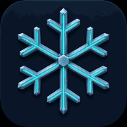
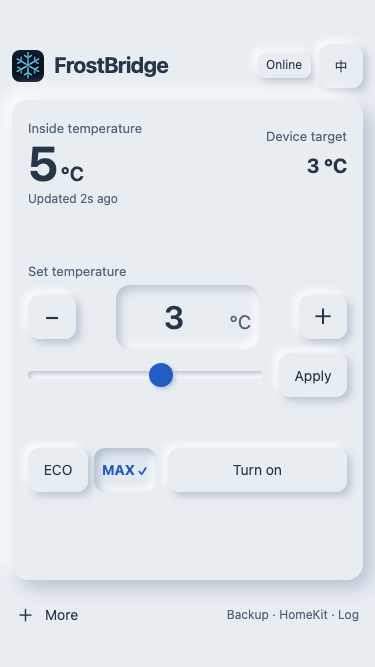

<div align="center">
  
  <h1>FrostBridge</h1>
  <p>An ESP32 Web / HomeKit bridge for <strong>Alpicool / Brass Monkey fridges</strong>.</p>
  <p>
    <a href="LICENSE"></a>
    
    
  </p>

[简体中文](README.zh-CN.md) | [English](README.md)

  <p>
    <a href="#why-i-built-frostbridge">My story</a> ·
    <a href="#what-it-does">Features</a> ·
    <a href="#quick-start">Quick start</a> ·
    <a href="docs/en/usage.md">Usage</a> ·
    <a href="docs/en/troubleshooting.md">FAQ</a> ·
    <a href="#license-and-attribution">Credits</a>
  </p>
  
  <p><sub>English by default · demo readings</sub></p>
</div>

> [!NOTE]
> Development snapshot. Manual Web/Home controls have been validated on one C15 with a classic ESP32 (4 MB flash, no PSRAM). Daily backup defaults off; real full-day learning, takeover/recovery and 48-hour acceptance are still pending. Other fridge protocols and ESP32 variants remain unverified.

## Why I built FrostBridge

I recently bought a portable compressor fridge for long road trips and work travel. Between trips, I keep it in my bedroom as a drinks fridge. That turned out to have one drawback: the compressor is loud enough to disturb my sleep.

What I wanted was simple: **chill my drinks before I return to the bedroom, then automatically turn the fridge off before I go to sleep — every day.** I did not want to remember to do it manually each night.

So I built FrostBridge to bring the fridge into Apple Home. I use HomeKit for everyday control and recurring automations, with a local webpage for direct control of temperature, power and ECO/MAX.

FrostBridge runs locally on ESP32. It needs no FrostBridge cloud backend/account, AI assistant, Node.js or separate home-automation server. Apple Home follows Apple’s own account and home-hub requirements.

## What it does

- One-screen Web controls at **http://frostbridge.local**, with English by default and an optional, remembered Chinese language switch.
- Apple Home power, ECO and native Celsius temperature accessories, plus separate fixed-time automation inputs.
- Device readback confirms changes. Stale readings, failed commands and backup errors remain visible.
- Optional daily backup learns confirmed actions from a complete Beijing-time day (UTC+8); it does not import Home app rules. Incomplete days keep the old sample; a complete empty day makes no changes.
- Static assets in flash; no CDN or runtime compression. USB updates on a single 3 MB app partition; **no OTA**.

## Quick start

**Hardware used in this project:** Waveshare **ESP32-DEV-KIT-WROOM-32E-N4**, a classic ESP32 development board with 4 MB flash and no PSRAM. This is the board used for the project's physical validation.

**Using another fridge?** You can scan/select it without editing C15 names in source. Only the author's C15 is physically verified so far; other single-zone devices need protocol/state checks, and second-zone control is not implemented. See [compatibility and how to help verify your model](docs/en/compatibility.md).

Use a dedicated **classic ESP32 with at least 4 MB flash**, a USB data cable, a supported C15 within BLE range, and 2.4 GHz personal Wi-Fi. Python **3.10+** is required. macOS is the validated host; Windows/Linux commands are provided but their complete hardware flows have not been verified here.

Download/extract the source, open a terminal in the project directory, then run:

```sh
python3 frostbridge.py setup
python3 frostbridge.py build
python3 frostbridge.py ports
```

Replace `PORT` below with your board's actual port (`COM5` on Windows is an example, not a default). On Windows use `py -3` in place of `python3`.

```sh
python3 frostbridge.py flash --port PORT
python3 frostbridge.py wifi --port PORT
python3 frostbridge.py bind --port PORT
python3 frostbridge.py pair --port PORT
```

Wi-Fi passwords are entered hidden and sent over USB to ESP32, never passed as arguments. `bind` lists candidates and asks you to select your own fridge in the **same USB session**. Close the factory app/nRF Connect first. The pair command opens a private local QR page on the computer. Scan it with iPhone/iPad Home → + → Add Accessory, or enter the displayed setup code. This is not a Wi-Fi QR code; configure Wi-Fi first. Do not publish it.

Open **http://frostbridge.local**. If mDNS is unavailable, use the ESP32's router-assigned IP. Save a bookmark/home-screen shortcut. Switching Web language does not rename accessories in Apple Home. `gateway` supplies English factory accessory names by default. For Chinese names, add `--homekit-language zh-CN` to build/flash (`gateway_zh`). Existing Home app names may remain cached or customized; rename them in Home as needed, without resetting pairing.

See the [step-by-step setup](docs/en/getting-started.md), [usage guide](docs/en/usage.md) and [troubleshooting](docs/en/troubleshooting.md).

## Development and source sharing

```sh
python3 frostbridge.py doctor
python3 frostbridge.py test
python3 frostbridge.py export --output .local/dist/FrostBridge-source.zip
```

Host tests need `clang++` with AddressSanitizer/UndefinedBehaviorSanitizer; build `gateway` once before tests to fetch ArduinoJson. PlatformIO regenerates Web assets automatically. Plain `pio run` now targets the production gateway; `basic`, `coexistence` and `readout` are developer diagnostics.

The export command creates a source-only ZIP without Git history, private captures, credentials, local tools or internal development records. It does not publish anything. Existing development history is not rewritten. Use the clean source package to start a public repository after review.

[Contributing](CONTRIBUTING.md) · [Architecture and validation](docs/en/development.md) · [Security and privacy](SECURITY.md)

## License and attribution

FrostBridge-owned code and documentation use the [MIT License](LICENSE). Dependencies retain their own licenses; MIT does not replace the Arduino core's LGPL or other upstream terms. See [Third-party notices](THIRD_PARTY_NOTICES.md) before redistributing firmware binaries.

Protocol reference: [BrassMonkeyFridgeMonitor](third_party/BrassMonkeyFridgeMonitor/README.md), MIT © Ben Peddell. The mechanical snowflake icon was generated with an image model; no brand affiliation is implied. FrostBridge is a community project, not an Apple-certified or Alpicool-endorsed accessory.
