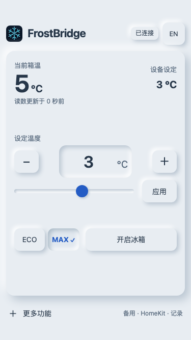

<div align="center">
  
  <h1>FrostBridge</h1>
  <p>面向 <strong>Alpicool / Brass Monkey 冰箱</strong>的 ESP32 Web / HomeKit 桥接项目。</p>
  <p>
    <a href="LICENSE"></a>
    
    
  </p>

[English](README.md) | [简体中文](README.zh-CN.md)

  <p>
    <a href="#为什么做这个项目">我的故事</a> ·
    <a href="#功能">功能</a> ·
    <a href="#快速开始">快速开始</a> ·
    <a href="docs/zh-CN/usage.md">使用说明</a> ·
    <a href="docs/zh-CN/troubleshooting.md">常见问题</a> ·
    <a href="#许可与致谢">致谢</a>
  </p>
  
  <p><sub>中文界面（可选） · 示例读数</sub></p>
</div>

> [!NOTE]
> 当前为开发快照。网页／家庭手动控制已在一台C15与经典ESP32（4MB Flash、无PSRAM）上验证。每日备用默认关闭，真实完整日学习、接管／恢复和48小时验收仍待完成；其他冰箱协议及ESP32型号尚未确认兼容。

## 为什么做这个项目

前不久，我买了一台车载压缩机冰箱，准备在长途旅行或出差时放在车上。其他时间，我会把它放在卧室里，当作冷饮冰箱。使用后遇到了一个问题：压缩机工作时的噪音比较明显，可能影响睡眠。

我想要的其实很简单：**回卧室前，饮料已经冰好；准备睡觉时，冰箱能够自动关闭。每天按这个节奏循环，不用临睡前再想起来手动操作。**

所以我开发了FrostBridge，把冰箱接入Apple家庭，用HomeKit做日常控制和循环自动化，也保留一个随手可用的本地网页，用来调温、开关机和切换ECO/MAX。

FrostBridge在ESP32本地运行，不需要自己的云后台或账号，也不依赖AI助手、Node.js或额外自动化服务器。Apple家庭仍遵循Apple自身的账号与家庭中枢要求。

## 功能

- **http://frostbridge.local** 一屏日常控制；网页默认英文，可手动选择中文并在本浏览器记住。
- Apple 家庭提供电源、ECO、原生摄氏温控和独立的固定时间自动化入口。
- 设备新鲜回读才确认设置；过期读数、失败命令与备用错误可见。
- 可选每日备用：学习北京时间完整自然日实际确认的动作，不导入家庭App规则。不完整日保留旧样本，完整空白日不主动改变冰箱。
- 静态资源保存在 Flash，无 CDN 和运行时压缩。单应用 3MB 分区，通过 USB 更新，**没有 OTA**。

## 快速开始

**本项目实际使用的硬件：** 微雪（Waveshare）**ESP32-DEV-KIT-WROOM-32E-N4**，经典 ESP32 开发板，4MB Flash、无 PSRAM。项目中的实机验证均使用这块开发板完成。

**使用其他型号？** 无需修改源码中的 C15 名称即可扫描、选择设备。目前只有作者的 C15 做过实机验证；其他单区设备需核验协议与状态，第二温区控制尚未实现。参见[兼容性及其他型号核验流程](docs/zh-CN/compatibility.md)。

准备专用的**经典 ESP32、至少4MB Flash**、USB数据线、蓝牙范围内的受支持 C15、2.4GHz 个人 Wi-Fi，以及 **Python 3.10+**。已验证的主机为 macOS；Windows/Linux 提供对应命令，但本项目尚未实测其完整硬件流程。

下载并解压源码，在项目目录打开终端：

```sh
python3 frostbridge.py setup
python3 frostbridge.py build
python3 frostbridge.py ports
```

将下方 `PORT` 替换为刚列出的实际板子端口。Windows 使用 `py -3` 替代 `python3`；例如 `COM5` 只是示例，不是固定端口。

```sh
python3 frostbridge.py flash --port PORT
python3 frostbridge.py --lang zh-CN wifi --port PORT
python3 frostbridge.py --lang zh-CN bind --port PORT
python3 frostbridge.py --lang zh-CN pair --port PORT
```

密码隐藏输入，只经USB发给ESP32，不接受密码参数。`bind` 在**同一次串口会话**里列出候选并让你选择自己的冰箱；先退出原厂App和nRF Connect。pair命令会在电脑打开私人本地二维码页。用iPhone/iPad家庭→＋→添加配件扫描电脑二维码，也可输入设置码；它不用于Wi-Fi配网，请先完成wifi步骤。不要公开配对码。

打开 **http://frostbridge.local**；mDNS不可用时，使用路由器分配的ESP32地址。可存书签／添加到主屏幕。网页语言不会重命名 Apple 家庭配件；默认 `gateway` 提供英文名称；需要中文配件名时，在 build/flash 时加 `--homekit-language zh-CN`（`gateway_zh`）。既有家庭名称可能被缓存或已自定义，可在家庭 App 中重命名，不需要重置配对。

详细步骤见[安装与配对](docs/zh-CN/getting-started.md)、[使用说明](docs/zh-CN/usage.md)与[故障排查](docs/zh-CN/troubleshooting.md)。

## 开发与源码分享

```sh
python3 frostbridge.py doctor
python3 frostbridge.py test
python3 frostbridge.py export --output .local/dist/FrostBridge-source.zip
```

主机测试需要带 ASan/UBSan 的 `clang++`；先构建一次 gateway 下载 ArduinoJson。PlatformIO 会自动生成网页资源，普通 `pio run` 默认构建生产 gateway；`basic`、`coexistence`、`readout` 为开发诊断环境。

导出命令仅创建源码ZIP，不带Git历史、私人捕获、凭据、本地工具和内部开发记录，也不会发布任何内容。原开发仓库历史不改写；准备公开时，先检查干净源码包，再从中建立公开仓库。

[参与开发](CONTRIBUTING.zh-CN.md) · [架构与验证](docs/zh-CN/development.md) · [安全与隐私](SECURITY.md)

## 许可与致谢

项目自有代码和文档采用 [MIT](LICENSE)。依赖继续使用各自许可，MIT不替代Arduino核心的LGPL等上游条款；分发固件二进制前请阅读[第三方说明](THIRD_PARTY_NOTICES.md)。

FrostBridge 使用了以下项目：

| 项目 | 在 FrostBridge 中的用途 |
|---|---|
| [HomeSpan](https://github.com/HomeSpan/HomeSpan/tree/2.1.8) | ESP32 上的 HomeKit 配对、配件服务／特征与通信。 |
| [NimBLE-Arduino](https://github.com/h2zero/NimBLE-Arduino/tree/2.5.1) | BLE 发现、连接、冰箱通知接收与命令传输。 |
| [ArduinoJson](https://github.com/bblanchon/ArduinoJson/tree/v7.4.3) | Web API 的 JSON 解析与生成。 |
| [Arduino-ESP32](https://github.com/espressif/arduino-esp32/tree/3.3.12) / [ESP-IDF](https://github.com/espressif/esp-idf/tree/v5.5.5) | 硬件、Wi-Fi、TCP/IP、mDNS、时间与持久化存储基础。 |
| [PlatformIO](https://github.com/platformio/platformio-core/tree/v6.2.0) | 依赖管理、固件编译与 USB 刷写。 |
| [PySerial](https://github.com/pyserial/pyserial/tree/v3.5) / [python-qrcode](https://github.com/lincolnloop/python-qrcode/tree/v8.2) | 电脑端 USB 配置与本地 HomeKit 配对二维码生成。 |

协议研究参考 [BrassMonkeyFridgeMonitor](third_party/BrassMonkeyFridgeMonitor/README.md)（MIT © Ben Peddell），以及 [Alpicool50l12vfridgefreezer](https://github.com/dandwhelan/Alpicool50l12vfridgefreezer/tree/3f7ec01eced922aae431bb90e9c92ac9a60bb0c2) 的分型号布局分析；另用 [alpicoold](https://github.com/johnelliott/alpicoold/tree/8530ecba99823461bcebfc20e62082771bb55fba) 与 [alpicool-esp32-mqtt](https://github.com/jakub-hajek/alpicool-esp32-mqtt/tree/397028e69fd5c26a68d44d19557f09bfb7f95449) 交叉核对布局。这些属于协议研究来源；本项目自行实现 C++ 协议、控制与回读确认、每日备用及 Web／HomeKit 适配。

机械雪花图标由图像模型生成，不代表任何品牌关联。FrostBridge是社区项目，不是经Apple认证或Alpicool背书的配件。
